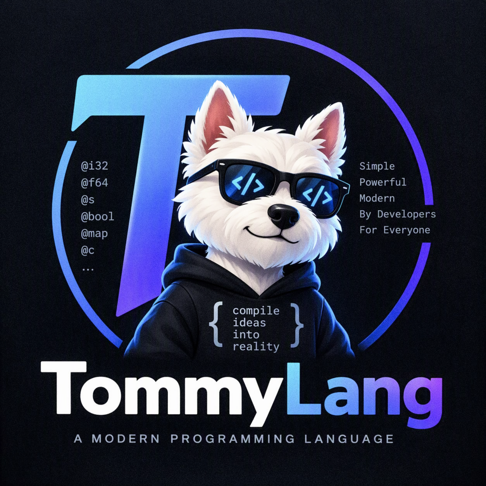

<table border="0" cellspacing="0" cellpadding="10">
  <tr>
    <td valign="middle">
      
    </td>
    <td valign="middle">
      <h1>🏛 tommylang (Tommy): The Universal Architecture Language</h1>
    </td>
  </tr>
</table>

[](https://marketplace.visualstudio.com/items?itemName=TommyStore.tommycolor)
[](https://opensource.org/licenses/MIT)

**Are you tired of AI generating 500 lines of C# with missing dependencies and broken architecture?**
**Are you spending hours reviewing AI-generated boilerplate?**

**Tommy solves this.** It is an AI-native programming language designed for the era of Large Language Models. It does not replace C#, Python, or Rust. It **orchestrates** them.

Instead of writing boilerplate code, you write **Architectural Blueprints** (`.ty` files). One blueprint generates perfect, production-ready code across 12+ languages.

---

## 📖 Table of Contents
1. [Why Tommy?](#-why-tommy)
2. [Quick Start](#-quick-start)
3. [How it Works](#-how-it-works)
4. [Core Features](#-core-features)
5. [Examples](#-examples)
6. [Repository Structure](#-repository-structure)
7. [Roadmap](#-roadmap)
8. [Contributing](#-contributing)

---

## 🚀 Why Tommy?

1. **Hallucination-Resistant:** Our prompt forces LLMs (GPT-4o, Claude 3.5) to act as strict AST compilers, not text generators.
2. **Polyglot by Design:** Write once in `.ty`, transpile to C#, Python, Rust, Go, PHP, TypeScript, Solidity, and more.
3. **Enterprise-Ready:** Built-in annotations for `[Saga]`, `[Outbox]`, `[GDPR]`, `[Kafka]`, and `[Telemetry]`.
4. **Semantic Typography:** The official `TommyColor` VS Code theme uses color to separate Interfaces (Purple), Classes (Green), and Functions (Blue).

---

## 🛠 Quick Start

### Step 1: Install the Extension
1. Open VS Code.
2. Go to Extensions (`Ctrl+Shift+X`).
3. Search for **[TommyColor](https://marketplace.visualstudio.com/items?itemName=TommyStore.tommycolor)** and install it.
*(This theme colors your code so it looks like an architecture blueprint).*

### Step 2: Write the Blueprint (`.ty`)
Create a file named `main.ty` and write your architecture using Tommy syntax:

```tommy
@struct user_dto {
    id = @i32 0
    name = @s ''
}

[REST('/api/hello')]
[Cache(ttl = 60s)]
say_hello (@user_dto user) {
    ? user.name == '' {
        <= bad_request('Name is required')
    }
    <= ok('Hello, ' + user.name)
}
```

### Step 3: Transpile to Target Language

**Option A: Manual AI Use (No Setup)**
1. Open ChatGPT or Claude.
2. Copy the contents of **[`COMPILER_PROMPT.md`](COMPILER_PROMPT.md)** and paste it as a System Prompt.
3. Paste your `main.ty` code and add the instruction: *"Target: C#"*.

**Option B: Using the CLI (Recommended)**
"One command — ready code."
1. Clone the repo and navigate to `cd cli`.
2. Install the compiler: `pip install -e .`
3. Set your API key: `export OPENAI_API_KEY="your-key"`
4. Run the compiler: `tommycli main.ty --target csharp`

*(Read the full [CLI documentation here](cli/README.md)).*

**The AI will generate:**
1. A `<pre-flight>` architecture plan (checking security, DI scopes).
2. UML diagrams (Mermaid & PlantUML).
3. Production-ready C# code (or Python, Rust, etc.).

---

## 🧠 How it works

Tommy is built on top of a meticulously crafted **System Prompt**. 

```text
[Your .ty code] + [Tommy System Prompt] ---> [LLM] ---> [Clean Target Code + UML]
```

Because the prompt enforces strict rules (e.g., snake_case for functions, = for all data, no return types in implementations), the AI is forced to generate code that is identical in architecture across all target languages. While LLMs are still probabilistic, this Strict-API approach minimizes hallucinations to near zero.

### The Difference: Plain AI vs. Tommy
If you ask ChatGPT to build a microservice with Kafka, it generates 500 lines of boilerplate with missing dependencies. 

With Tommy, you write this:
```tommy
[Kafka(topic = 'orders')]
[Saga]
process_order (@order_dto order) {
    @db.query('INSERT INTO orders ...', { id = order.id })
    [Event('order_created')].publish({ id = order.id })
    <= ok('Processed')
}
```

**Why not just use C# directly?**
If you write C# and ask AI to translate it to Rust, the AI has to filter out C#-specific paradigms (`Task`, `var`, DI attributes). It often fails. Tommy is a clean, abstract blueprint. It contains zero language-specific boilerplate. The AI translates pure intent directly into the target language's idiomatic code.

---

## 💎 Core Features

*   **Semantic Types:** `#Interface`, `@Class`, `@struct`, `@p` (property).
*   **Built-in System Responses:** `ok()`, `created()`, `bad_request()`, `not_found()`, `server_error()`.
*   **Enterprise Architecture:** `[Saga]`, `[Outbox]`, `[Idempotent]`, `[CircuitBreaker]`, `[RateLimit]`.
*   **Security & Compliance:** `[Auth]`, `[Encrypt]`, `[PII]`, `[GDPR]`, `[AuditLog]`.
*   **OS-Level (Bare-Metal):** `[NoRuntime]`, `[Ring(0)]`, `[Interrupt]` -> generates Rust `#![no_std]`.
*   **AI & ML:** `[ML]`, `[Agent]`, `@llm.complete()`.
*   **UML Generation:** `[UML]` -> generates Mermaid & PlantUML diagrams on the fly.

---

## 📂 Examples

Explore the power of Tommy in the [`examples/`](examples/) folder:
* [Basics](examples/basics.ty) — Variables, loops, and types.
* [Collections](examples/collections.ty) — Lists, maps, and sets.
* [OOP & Interfaces](examples/oop.ty) — Classes, properties, and UML.
* [REST API](examples/api.ty) — Endpoints, caching, and security.
* [Microservices](examples/microservice.ty) — Saga, Outbox, and Kafka.
* [Concurrency](examples/concurrency.ty) — Async, mutexes, and channels.
* [AI & ML](examples/ai_agent.ty) — XGBoost and LangChain agents.
* [OS Kernel](examples/os_kernel.ty) — Bare-metal interrupts (Rust target).

---

## 📂 Repository Structure

*   **[COMPILER_PROMPT.md](COMPILER_PROMPT.md)** — The actual "compiler" (System Prompt v18.3).
*   **[SPECIFICATION.md](SPECIFICATION.md)** — The strict syntax and architectural rules of Tommy.
*   `examples/` — 8 production-ready `.ty` blueprints (from Basics to OS Kernel).
*   `cli/` — The `tommycli` compiler (Python). [Read the CLI Docs here](cli/README.md).

---

## 🗺 Roadmap

Tommy is in early alpha. Here is what's coming next:
* [ ] **Formal Grammar (BNF):** A strict grammar specification for `.ty` files.
* [ ] **LSP & Validator:** A Language Server to catch syntax errors before sending code to the LLM.
* [ ] **Multi-LLM Support:** Native support for Claude 3.5, Gemini Pro, and local models (Ollama) in `tommycli`.
* [ ] **CI/CD Tests:** Automated compilation tests for generated code.

---

## 🤝 Contributing
Tommy is open for architects, AI researchers, and developers. We believe that in the future, humans will design software, and AI will write the boilerplate. Tommy is the bridge between the two.

Read the **[SPECIFICATION.md](SPECIFICATION.md)** to learn the syntax and start writing blueprints.
```